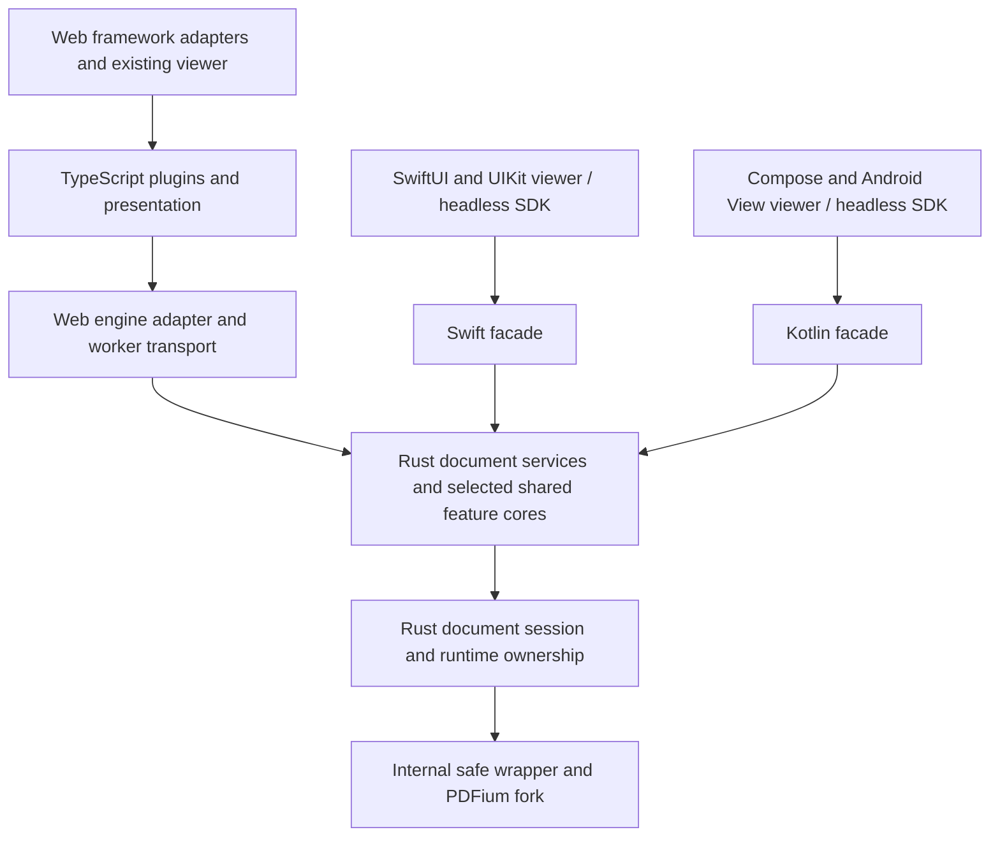

# EmbedPDF multiplatform plan

Date: 2026-09-08. Scope: web, iOS, and Android, with a shared Rust core and native platform SDKs. This is a proposed implementation and release plan, not a claim that the prototype is production-ready.

## Recommendation

Build a Rust document engine first, retain the existing TypeScript viewer on web, and build Swift and Kotlin viewers over the same document operations. Expand Rust into selected interaction and rendering-planning features only when real workloads justify the boundary. A multiplatform release does not require replacing the entire TypeScript kernel, plugin system, or UI.

Use the next major version to establish explicit resource ownership, consistent errors and cancellation, and a durable internal operation contract. Preserve the familiar web engine, plugin, framework, and finished-viewer surfaces through adapters wherever their behavior can remain correct. Native consumers should receive Swift and Kotlin APIs designed for their languages, rather than translated TypeScript or raw generated bindings.

Deliver incrementally: a reproducible runtime; a production read-only engine; native reader SDKs and viewers; document editing; then shared interactive editing. Web can retain existing capabilities while mobile support grows. The initial mobile product target is a usable reader with scrolling, zoom, search, selection/copy, links, accessibility, and annotation display. Annotation creation/editing is a subsequent explicit milestone. This scope is a planning assumption, not a conclusion from the benchmarks.

## What the experiments establish

Use the committed result tables and updated prototype README as the evidence. Older research summaries contain different timings and limitations that later work corrected.

| Evidence | Finding | Consequence |
|---|---|---|
| [PDFium binding results](pdfium-binding-benchmarks/RESULTS.md) | On the measured WASM workload, geometry took 2.788 ms through direct per-item calls versus 1.070 ms through coarse Rust operations; search took 102.36 µs versus 30.61 µs. Coarse C++ performed similarly. | Put loops and their data behind the boundary. The advantage is operation granularity, not an intrinsic Rust advantage. |
| Same results | Thin Rust wrappers added roughly 1–4% on the measured substantive workloads. Rendering did not benefit from coarsening; separately linked modules also showed unresolved timing differences. | Avoid promising faster rasterization. Measure the final linked module and the complete pixel delivery path. |
| Same results, native table and harness | Native geometry measured 4.134 ms in thin Rust arm b versus 577.37 µs in coarse Rust arm c, about 7.16×; search measured about 1.62×. Both arms use the same napi-rs addon. The later readBytes/readU16 copy fix does not affect these geometry/search timing paths, which use scalar reads or viewBuffer. | These are valid workload-specific boundary measurements, not mobile or whole-engine forecasts. Rerun text and pixel/readback paths affected by the later copy fix; do not infer their benefit from geometry. |
| [Viewer port result tables](viewer-rust-port-benchmarks/bench/RESULTS.md) | Geometry-only Rust won none of 20 frame cells. Rust geometry plus state also never won a frame cell. At 1,000 anchored/projecting shapes: TypeScript 121.96 µs, Rust with object decoding 200.76 µs, Rust raw output 171.43 µs. | One crossing per frame is necessary discipline, not proof of a fast design. Keep inexpensive web projection local unless real-feature measurements support moving it. |
| Same viewer results | Dispatch at 1,000 shapes improved from 3.70 µs to 1.92 µs, but Rust lost at smaller counts. The implementations differ in immutable replacement versus mutation. | Compare against an optimized TypeScript baseline before attributing a gain to Rust. |
| Same viewer results | Object decoding is material and workload-dependent. Allocation samples omit typed-array backing stores. Cold-start samples use cached localhost assets. | Measure copying, allocation, network startup, and rendering separately. Do not treat these samples as complete memory or download evidence. |
| [Multiplatform prototype](pdfium-multiplatform-prototype/README.md) | Rust/PDFium operations bind to WASM, Swift, Kotlin, and Node. Local iOS simulator and Android emulator builds displayed rendering, text, and search. | The basic architecture is feasible; reuse the learning and reviewed low-level code, not the prototype's entire public surface. |
| Prototype and [platform audit](docs/research/platform-gap-audit.md) | Mobile and WASM-EH release pins remain pending; local builds work. Device distribution, release-browser coverage, bounded scheduling, cancellation, and lifecycle hardening remain incomplete. | These are named delivery gates, not reasons to restart the architecture experiment. |

The viewer experiment is a rectangle toy, not an annotation editor benchmark. The binding timings are primarily one machine and fixture workload; p95 values are batch-mean percentiles, not user-operation tail latency. Neither experiment proves performance across browsers or phones.

## Architecture and ownership

The diagram shows the destination. During migration, existing TypeScript services remain in the web worker alongside narrowly ported Rust operations under the ownership rules below.

| Layer | Owns | Stays outside it |
|---|---|---|
| Internal runtime binding | Generated fork ABI, unsafe calls, checked lengths, RAII resources, pixel descriptors | Public consumer API and viewer state |
| Rust document session | Document bytes and handles, page identity, page leases, revisions, mutation sequence, retained import resources, shutdown ordering | Framework stores and UI objects |
| Rust services | Coarse reads/mutations, text layout and search semantics, annotations, forms, save/export, shared validation and authorization rules | Host network/file pickers and transport envelopes |
| Optional Rust feature cores | Coherent interaction state machines, expensive geometry, hit testing, scene or tile planning where justified | Individual DOM events, UI widgets, platform image handles |
| Platform adapters | Scheduling bridge, DTO conversion, async/error idioms, image ownership, file/network integration | A second implementation of document correctness |
| Platform presentation | Scroll/zoom mechanics, accessibility, input/IME, focus, clipboard, menus, framework integration and native drawing | PDF mutation rules and duplicate authority decisions |

Follow the existing `runtime/shared → document-session → features → worker-host` dependency direction. Preserve Reader/Mutator responsibilities. The Rust service crate must not depend on UniFFI, browser APIs, UIKit, or Android types. Binding crates depend on it. Start a production Cargo workspace with internal runtime-sys, runtime, document-services, and host-binding crates; add feature crates when an actual independent consumer exists. Proposed crate names are internal. New npm packages must follow repository path-derived naming.

The prototype's `pdfium-sys` and safe wrapper are starting points for review. Its operation objects, dispatch, and host adapters are scaffolding to redesign. Audit unsafe boundaries and lifecycle assumptions before promoting them.

### Runtime topology

On web, link Rust document services and PDFium into **one Emscripten module in a dedicated worker**, using the prototype's proven linkage route as the starting point. Do not split them into separate WASM heaps connected by per-PDFium-call JavaScript. A small, independent pure-Rust feature module is possible later if it demonstrably benefits main-thread interactions; it must not duplicate PDFium or force all web consumers to initialize WASM.

On native platforms, thread-safe exported engine objects submit jobs to a dedicated OS thread that owns all PDFium resources. A Swift actor, coroutine dispatcher, or mutex alone does not pin execution to that thread. Keep the actual handle-bearing types non-Send/non-Sync. Initialize and shut down PDFium on the owner thread and release dependent resources before the library.

Begin with one owner thread per engine and a conservative engine count. Additional native workers require the fork's TLS-enabled build, sticky document routing, and the repository's TSAN/soak gates. WASM instances isolate their own globals. Coordinate multi-document operations on one owner; do not pass source-document handles across owners for page import. Transfer source data or reopen a controlled source snapshot on the destination owner when necessary.

Thread confinement is not crash isolation. A native fault in an in-process mobile engine can terminate the app. Do not advertise `catch_unwind` as containment or rollback. Keep server isolation behind the existing engine-host architecture; mobile process isolation is a separate platform-specific investigation, not a prerequisite for this reader release.

## Boundaries designed for performance

Expose page geometry, text extraction/search, render requests, annotation batches, and whole mutations. Do not export arbitrary `FPDF_*` calls or make one host call per glyph, annotation point, or rectangle corner.

Use typed records for small control messages and compact buffers for large geometry, ink, search, and pixel payloads. Keep expensive objects resident in their owning core. Cache by document/page identity, revision, view parameters, and rendering policy; emit deltas or visible-region results instead of serializing the whole document every frame.

Define buffer layout, version, alignment, stride, pixel format, alpha mode, color space, allocator, release operation, and lifetime in the contract. Validate multiplication and input lengths before allocating. Never free a Rust allocation by guessing its capacity. Returned handles must carry an engine generation so stale resources cannot become valid after replacement.

On web, rebuild heap views after WASM memory growth. A view into WASM memory is a short-lived internal borrow; transfer independently owned buffers across workers, or use a proven image-transfer path. Record the WASM-to-host copy, worker transfer, channel conversion, and GPU upload separately. Transferable buffers eliminate particular copies, not the whole pipeline.

On iOS and Android, prefer native image creation from explicitly owned buffers. Benchmark UniFFI byte sequences against a specialized buffer bridge before selecting the bitmap path. A small C/JNI bridge for pixel ownership is acceptable if needed; keep service semantics in Rust. Do not promise zero-copy CGImage/Bitmap delivery without testing lifetime and format requirements.

Preserve visible-first tile scheduling and retained low-resolution imagery while sharper tiles arrive. Port the existing render planning behavior using `packages/plugin/render` as the behavioral reference. A future shared planner can return tile demands and invalidations; native wrappers retain ownership of compositor resources. Avoid a full-page high-resolution render on every pinch or scroll event.

For interactions, batch sampled pointer input where appropriate, preserve order, and avoid crossing for every primitive. Keep immediate scroll/zoom and presentation feedback on the UI thread. If a Rust interaction core is introduced, move a complete state/command/result loop; its output should be consumable without rebuilding a large object tree. Benchmark simple and complex annotations, ink, cloudy borders, snapping, and hit-test misses against improved TypeScript.

### Explicit exclusions for this release

Keep `packages/core/annotation`, `packages/core/main`, and `packages/core/stage` in TypeScript on web throughout this program. Do not replace the web kernel/store, port web framework adapters or viewer chrome into Rust, or require WASM initialization for existing synchronous pure TypeScript packages. Native annotation interaction logic may be implemented in Rust with shared vectors while web retains its existing implementation.

Shared tile planning is outside the initial reader/engine delivery. A later proposal must identify its consumers, ownership, and measured benefit before adding it. Reopening any of these exclusions requires an explicit scope change backed by representative end-to-end measurements; the toy benchmark supports the current exclusion but does not establish a permanent limit on future implementations.

## Public SDK design

Share semantics, supported capabilities, and conformance fixtures. Public method spelling, collections, observation, and resource helpers should be idiomatic per platform. Generated bindings are an implementation detail; maintain thin handwritten facades and compile real consumer examples in CI.

| Concern | Web | iOS | Android |
|---|---|---|---|
| Async operations | Preserve current engine task/AbortablePromise behavior through an adapter where feasible; offer AbortSignal integration | `async throws`, task cancellation, main-actor observable viewer state | `suspend`, coroutine cancellation, StateFlow/Flow |
| UI delivery | Existing framework composition packages and finished viewer wrappers | Headless SDK plus SwiftUI view and UIKit integration | Headless SDK plus Compose viewer and Android View integration |
| Inputs and outputs | Existing JS byte and document conventions | Data/URL inputs, native geometry and image conveniences | ByteArray/Uri inputs, platform geometry/image conveniences |
| Errors | Stable typed engine codes and details | Typed errors with appropriate recovery information | Typed exceptions/results consistent with Kotlin call sites |
| Cleanup | Explicit async close/destroy; finalization only a fallback | Explicit async close and scoped helper; deinit schedules fallback cleanup | Scoped suspending helper and explicit close-and-await; AutoCloseable cleanup must not block the UI |
| Observation | Existing selectors/subscriptions, stable unchanged snapshot identity | Observable state / AsyncSequence of changes | Immutable UI state / Flow of changes |

Keep engine work off UI threads even if generated bindings are synchronous. Hide the prototype's Kotlin `closeSync` and generated `close` collision behind a documented lifecycle facade. Distinguish “reject new work and schedule disposal” from “all native resources have been released”; helpers must expose which guarantee they provide. Cancellation of a Swift task or Kotlin coroutine must reach the scheduler, not merely stop awaiting a blocking call.

Specify shared coordinate semantics: normalized page points, origin and axis direction, crop/rotation transforms, and device scale. Maintain durable page identity across reordering; an index is not identity. Specify the relationship between PDFium character indices, extracted text, UTF-16 offsets, Unicode scalars, and grapheme clusters. Swift conveniences may translate into String ranges only using a checked mapping. Add non-BMP and combining-text fixtures; the prototype's UTF-16 length test alone does not settle all search-index semantics.

Expose feature availability and the existing `can`-twin semantics through natural platform APIs. Native UI must use the capability's answer instead of reinterpreting scope strings. Engine/server enforcement remains authoritative. Preserve optimistic rollback and changes to permission-derived state. A missing mobile feature is explicitly unsupported, not a no-op that looks successful.

Host extensions remain platform-native: TypeScript plugins, Swift integrations, Kotlin integrations. Share stable commands, effects, and feature contracts when useful; do not attempt to execute arbitrary existing TypeScript plugins in Rust or bundle a JS runtime just to reuse web UI. Treat PDF form JavaScript separately: retain the current web path until a native sandbox and behavior contract are validated; mobile must explicitly report any unsupported scripts.

## Incremental migration without two owners of one document

The key migration unit is an operation or a coherent feature, with **one owner per resource and state transition**. “Some functions are now Rust” is not sufficient if both languages keep independent revisions or editable document copies.

### Stage A: coarse Rust reads inside the existing web engine

Keep the TypeScript DocumentSession as sole lifecycle/revision owner. Add private coarse Rust functions to the same worker's existing Rust/PDFium module. They borrow validated document/page handles synchronously for one operation, never retain them, never close them, and never create a second owning wrapper for them. Owned transient resources are released before return.

This is a deliberately internal migration bridge. Native callers use a Rust-owned session around the same service logic. Hide the borrowed-handle path from consumer packages, test close/borrow ordering, and prohibit it from crossing workers or WASM instances. Begin with page geometry and read-only text operations. A read that updates cache or weak-annotation knowledge returns that information to the session owner for application.

This obtains coarse-boundary benefits while preserving existing web features. It also avoids making full engine parity a prerequisite for useful work. The bridge is not a permanent public raw-pointer API.

### Stage B: move the session authority as one change

Before broadly porting mutators, move document bytes/lifetime, page leases and registry, revision authority, mutation sequence, password-locked state, and retained import dependencies together into Rust. Replace the TypeScript session implementation with a facade. Port consumers of each state field or delegate them; never maintain two authoritative counters.

Remaining TypeScript services may run through a private, synchronous owner-worker bridge against that same runtime/session. Lease handles for one scoped operation, prevent reentrancy, and finalize all mutation outcomes through Rust. This path is only for legacy web code and must have explicit removal criteria. If scoped borrowing cannot be made safe for a feature, keep that whole feature/session configuration on the legacy backend until its dependency cluster is ported.

Never route reads to a newly opened Rust document while writes continue against a separate TypeScript document. Never switch an open, edited document between backends. Select the backend at open; rollback means selecting legacy for subsequent sessions, or explicitly saving and reopening after user-visible recovery.

### Stage C: retire legacy services feature by feature

Port complete Reader/Mutator families behind unchanged web services. Rust owns validation, native work, mutation impact, cache invalidation, and revision publication; TypeScript retains request orchestration and presentation. Run existing conformance suites through both backends. Remove each old implementation and its bridge access when parity and performance gates pass.

Temporary duplicate pure algorithms, such as web and Rust geometry, use shared vectors and a named owner. Record why duplication exists and its exit criterion: switch web when measured budgets pass, or keep the small platform optimization deliberately. Do not force a slower web implementation solely to reach “100% Rust.”

## Execution phases and exit gates

These are dependency milestones, not calendar estimates. After Phase 1, estimate effort from actual service inventory and measured port velocity. Runtime/release engineering and native presentation can proceed concurrently with service work, provided they use a stable subset of the contract.

| Phase | Work and deliverable | Exit gate |
|---|---|---|
| 0. First integration and baseline | Link a Rust static library into the shipping web worker and implement one coarse page-geometry read through the Stage A bridge. In parallel, inventory API/feature scope, record baselines, and specify ownership, lifecycle, errors, and buffer contracts. Use reproducible local runtime inputs until Phase 1 publishes them. | A working geometry operation passes applicable conformance and is benchmarked against the current engine; the build is scripted with pinned inputs. Record initial performance budgets and the feature matrix. Contract work must not postpone this executable proof. |
| 1. Reproducible foundation | Establish production crate/binding boundaries; reviewed safe runtime wrapper; pinned matching fork headers/libraries/toolchain; worker and native-owner scheduling. Complete mobile and WASM-EH artifact release automation. Build fresh Swift and Android consumer apps. | Clean-checkout builds without cached private artifacts; released checksummed inputs; real module tested in supported release browsers; fresh simulator/emulator apps and signed physical-device smoke tests. |
| 2. Read-only Rust services | Stage A bridge; native Rust session; open/password/close, metadata/page layout, rendering/tiles, geometry, text/search, links and annotation reads. Preserve stable identities and permission behavior. | Existing applicable conformance suites pass on old and Rust web engines; native vectors and facade tests agree; cancellation/memory/lifecycle stress tests and reader performance budgets pass. Native headless SDK preview is usable. |
| 3. Native reader products | SwiftUI/UIKit and Compose/View components; continuous scrolling, pinch zoom, virtualized pages, text selection/copy, search navigation, links, annotation display, accessibility and file lifecycle. Keep web UI operating over its adapter. | Physical-device input/scroll/lifecycle/accessibility checks; no PDF work blocks the UI; useful reader samples install solely from distributable SDK artifacts. |
| 4. Session ownership and editing | Stage B; then port annotation writes and appearances, save/export, forms, page assembly, redaction, attachments and piece-info in dependency order. Port font/session dependencies as required. Ship supported families incrementally. | Mutation, save/reopen, document-event and revision conformance passes; cancellation-after-apply and partial native failure semantics are tested. No dual session authority. |
| 5. Shared interaction cores | Start with the feature that mobile editing needs and that amortizes its boundary: e.g. ink or annotation geometry plus editing state. Add native editing UI. Evaluate shared tile planning separately. | Real workload benchmarks on all three platforms justify each adopted boundary; interaction traces agree; performance and accessibility gates pass. Web may retain selected TS implementations. |
| 6. Major-version rollout | Stabilize platform facades; switch default web backend only for supported parity; publish migration tools/docs and synchronized SDK artifacts. Remove retired bridges and legacy code. | Existing web functionality is retained or explicitly documented as a major-version change; platform support matrix and packaging/compatibility tests pass; rollback procedure rehearsed. |

Phases 3 and 4 can overlap after the read contract stabilizes. A mobile reader release may precede native editing, but documentation must distinguish that from full web feature parity. The web default must not switch to an incomplete backend simply because the mobile reader milestone passed.

## Lifecycle, scheduling, and failure semantics

Implement these in the production foundation, rather than inheriting the prototype's unbounded channel:

- Bound queued jobs, open documents, input bytes, raster/cache bytes, search output, and concurrency. Admit work before allocating large inputs; reserve a cleanup/control route so saturation cannot prevent close or cancellation. Monitor process/WASM memory as well as tracked buffers because PDFium allocations are not all visible to Rust budgets.
- Prioritize visible rendering and interaction reads. Coalesce obsolete render demand, cancel queued work, and suppress results by request generation and document revision. Preserve mutation order and avoid starving cleanup or long-running operations.
- Check cancellation before work and before a mutation's apply boundary. For progressive operations, use supported pause points. A synchronous native call may remain non-preemptible; document that limit. Web cancellation messages cannot interrupt a worker blocked inside WASM without yielding or an explicitly supported shared cancellation mechanism.
- After the first native write, finish consistent bookkeeping. Do not introduce caller-validation or cancellation failures that pretend no write occurred. Ordered batches report failed/skipped items and finalize changed or indeterminate state as required by current service conventions. Multi-call mutations are not transactions.
- Close is idempotent, rejects new work, invalidates handles, drains or cancels admitted work according to contract, and releases resources on the owner. Closing an engine also closes its documents and retained dependencies. A delayed image consumer must retain its buffer owner until it is finished.
- Treat a panic after a potentially mutating operation as a potentially invalid session; poison/discard it unless an operation-specific invariant establishes safe continuation. Reject pending requests on worker failure. Support explicit engine recreation and new generation IDs; do not hide it behind an unrecoverable process-wide singleton.
- Reopening requires retained/reacquirable source data. Unsaved changes may be lost unless separately checkpointed. Never silently retry an indeterminate mutation. Backgrounding, memory warnings, rotation, view disposal, and Android process recreation need explicit presentation and session policies.

## Web compatibility and the major version

Keep npm names, framework component/hook patterns, configuration vocabulary, plugin capability tokens, and engine injection seams where practical. Existing asynchronous engine calls are the first compatibility boundary; a Rust implementation should ordinarily be invisible to those callers.

Preserve the built-in viewer entry point and the engine-injected `/core` entry point. The latter must remain free of PDFium symbols and WASM assets when used with a remote/custom engine. Framework wrappers remain engine-blind and boot once. Keep SSR import safe: defer workers/WASM initialization until the appropriate client lifecycle. Keep synchronous pure TypeScript packages usable without asynchronous Rust initialization.

Generate or mechanically check internal wire DTOs from a canonical schema/Rust definition; retain adapters where public web DTOs intentionally differ. Validate wire inputs at runtime and define numeric widths and unknown-enum behavior. Version the internal protocol/buffer layout and detect mismatched JS/WASM/native artifacts. Do not expose the generated Rust serialization layout as the public API.

Maintain a compatibility ledger per exported surface: unchanged, adapter-preserved, deprecated, or intentionally breaking. Likely breaks to evaluate include direct runtime/pointer access, undocumented worker protocol use, resource disposal guarantees, and cancellation behavior. Do not remove such surfaces merely because the version is major; document concrete before/after examples and provide codemods where practical. Typecheck representative downstream integrations and custom plugins, and exercise custom/CloudPDF engines independently.

Offer an opt-in Rust engine during preview. Keep a legacy backend build for a bounded transition, selected at document open. Define its removal condition as web feature/conformance coverage and performance acceptance, rather than an arbitrary date. New work goes into the owning implementation; critical fixes during overlap must be applied to both paths with a shared regression fixture.

## Validation and performance gates

Create a baseline before choosing final budgets. The following are proposed starting acceptance criteria, to confirm in Phase 0; they are not measured achievements:

| Area | Proposed gate |
|---|---|
| Frame responsiveness | Target 60 Hz on the supported baseline devices and 120 Hz on designated devices. Track missed frames and input-to-presentation latency. Reserve at most 2 ms p95 for SDK UI-thread scripting/interop in a 60 Hz interaction workload; measure separately at 120 Hz. |
| Web regression | Investigate repeatable >5% regressions in meaningful end-to-end workloads; block default rollout above 10% in p95 open/first-page/search latency or peak memory unless an explicit product budget replaces that threshold. Also apply absolute limits so tiny operations do not dominate decisions. |
| Native reader | Establish device-specific open-to-visible-page, search, sustained scroll, memory, and battery/thermal targets before beta. Benchmark cold and warm paths on older and current supported devices. Desktop Node timings are not the mobile budget. |
| Memory and startup | Stay within configured document/raster budgets; repeated open/render/close returns to a stable plateau. Track compressed JS/WASM size, compile/instantiate time, native download/install size, and uncached first useful paint on a controlled network. |
| Boundary design | Count calls, transferred bytes, allocations, and decode time. No per-glyph host calls in geometry/search. A batched frame path still has to pass actual timing gates. |

Use the existing `packages/engine/core/src/conformance` suites as behavioral oracles for geometry/orientation, text/search, annotation reads/mutations/appearance, forms, page edits, redaction, attachments, piece-info, and document events. Run them against the existing and Rust-backed web engine. Extract language-neutral vectors/traces for Swift/Kotlin and test their native facades; do not replace rich conformance coverage with the prototype's six operations.

Expand fixtures to rotated/cropped pages, non-BMP/combining/RTL text, large scanned PDFs, complex vector pages, fonts and ICC profiles, encrypted documents, forms, embedded attachments, malformed input, and dense annotations/ink. Check exact structural results and stable error codes. Use explicit color-channel/alpha tests alongside raster tolerances; a grayscale golden cannot detect channel swaps.

For performance, run fairness gates before timing, use equal work and release optimization flags, rotate/interleave variants, consume results, and retain raw measurements with source/artifact/toolchain hashes. Measure real operation latency distributions separately from batch-mean microbenchmarks. Include optimized TypeScript, Rust, marshalling-only, and raw-buffer variants when isolating a feature. Recollect the corrected native readback and viewer allocation results, including array buffers/external memory and WASM/native heaps.

CI should separate fast core/conformance tests, platform binding/package tests, real-browser and simulator/emulator jobs, and scheduled device/performance/soak runs. Include release Chrome, Firefox and Safari in the chosen browser matrix. Test the linked exception-handling module, not only a small EH probe. Test native ARM64 devices, iOS simulator, Android ARM64/x64 emulators, and supported Android page sizes with freshly built artifacts.

## Distribution and maintenance

Pin a single reviewed PDFium fork revision with matching headers and per-target checksums. The existing local-pin route remains useful for development; release verification must use published artifacts. Complete the release matrix for iOS device/simulator, Android ARM64/x64, and the chosen WASM-EH target. Publication requires an authorized maintainer; its availability should not block independent local engineering.

Ship an iOS Swift Package with a self-contained XCFramework, initially following the prototype's successful static-link approach, plus generated bindings and the Swift facade. Ship an Android Maven AAR with ABI-specific native libraries, the matching C++ runtime dependencies, generated binding runtime requirements, consumer shrinker rules, and Kotlin facade. Validate use from a fresh consuming app, including release/shrunk Android builds and signed physical iOS deployment. No developer-machine absolute paths may be required at runtime.

Pin a compatible Rust/Emscripten/Binaryen toolchain and test both panic handling and PDFium setjmp/longjmp behavior. The prototype's legacy-EH success in Chrome and Firefox Nightly does not establish Safari or release-Firefox support. Choose and document the supported browser floor only after real-module testing; if an alternate EH build is needed, price its maintenance and payload impact explicitly.

Keep Node/server bindings viable as downstream consumers without making Windows, musl, or new server rollout part of the first mobile release. Preserve the current CloudPDF contract and engine-injection route; server migration needs its own runtime/isolation validation.

Produce symbols, artifact manifests, third-party notices, and license inventories for all SDK deliveries. Release notes must follow the repository's one-changeset-per-directly-affected-package rule when implementation PRs land. Keep shared conceptual docs and platform-specific compiled examples; generate support reporting from exports/capabilities and sample coverage rather than asserting uniform parity.

## First implementation tranche

1. Capture the API/feature inventory and current reader performance corpus; rerun corrected native and allocation benchmarks.
2. Stabilize the six prototype operations behind production lifecycle/error/buffer contracts and pin reproducible runtime artifacts.
3. Implement bounded scheduling and owner-thread cleanup, with cancellation and partial-failure tests before mutation work.
4. Deliver the Phase 0 coarse page-geometry integration alongside the baseline and contract work through the Stage A borrowed-operation bridge; run applicable orientation/geometry conformance and end-to-end benchmarks. The items above are concurrent workstreams, not prerequisites to linking this first operation.
5. Package the same services behind handwritten Swift/Kotlin facades and build fresh minimal reader apps on physical devices.
6. Review those results before expanding to text/search and reader UI, or moving session authority and mutators.

The decision at that checkpoint is whether the production boundary meets correctness, responsiveness, and distribution requirements. Completing the port is measured by reliable platform capabilities and maintainable shared behavior, not by the percentage of TypeScript deleted.
