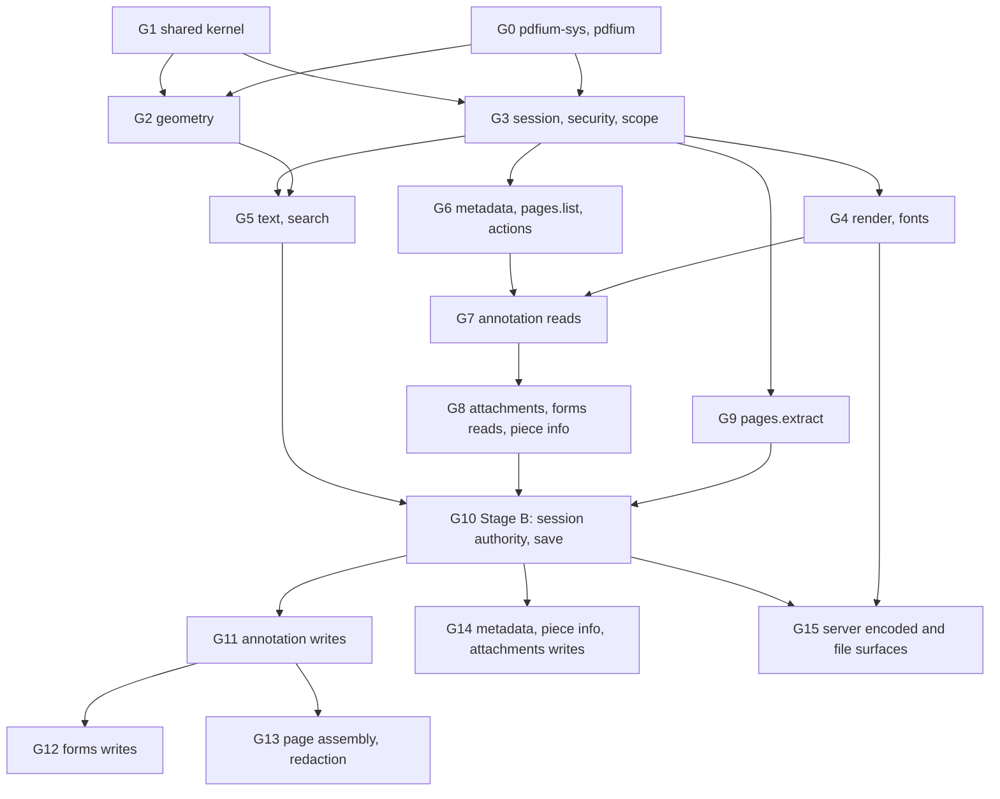

# TypeScript to Rust port order

Status: proposal. Date: 2026-09-09. Companion to `multiplatform-plan-claude-remix.md` (program) and
`multiplatform-port-hazards.md` (designs needing rework).

Line counts are from `wc -l` on non-test `.ts` files at commit `12574f5f4`. Operation names are
`WorkerRequest` kinds from `packages/engine/core/src/wire/worker-protocol.ts`. Suite names are files
in `packages/engine/core/src/conformance/`.

## 1. Grouping rules

1. A group is a set of modules that share one resource owner and one conformance gate. It lands as
   one PR series and flips as one routing entry.
2. Reads before writes. Stage A (TypeScript owns the session) covers groups G2 through G9. Stage B
   (G10) moves session authority. Stage C covers G11 onward.
3. Dependencies point downward in the table. A group never starts before every group it depends on
   has its gate green.
4. Filed by behavior, not by name prefix. `forms.list` and `forms.export` are reads (G8).
   `pages.extract` is a read (G9). `pages.renderEncoded` is a server surface (G15).
5. Native hosts get every group through a Rust-owned session from G3 onward. Web reaches G2 through
   G9 through the Stage A borrowed-handle bridge.

## 2. Source inventory

| Package | Lines | Ports | Stays TypeScript | Deleted |
|---|---|---|---|---|
| `packages/engine/services/src` | 16,620 | `document-session/` (832), `features/` (~13,900), `shared/` (151), `worker-host/WorkerHost.ts:1380-1414` (`finishMutation`, `saveLayerArtifact`) | `worker-host/WorkerHost.ts` message loop and transport (~1,420 of 1,459); `events/EventHub.ts` (99, adapter delivery used only by `engine/main`) | `runtime/memory/` (193): replaced by `bindgen` structs |
| `packages/engine/core/src` | 18,562 | `text/` (762), `search/` (655), `dto/` (1,565), `errors/` (150), `identity/` (215), `revision/` (64), `mutation/` (679), `geometry/` (300), `annotation/` kinds DTOs and pure helpers (~1,900), `forms/` (797), `auth/scope/` (904, deliberate duplicate), `events/DocumentEvent.ts` (179) | `wire/` (4,586), `engine/` interfaces (1,358), `promise/` (172), `resource/` (189), `annotation/relationships.ts`, `annotation/comments.ts`, `conformance/` | none |
| `packages/engine/main/src` | 5,568 | none | all (`LocalEngine`, `Local*Service`, transport, worker bootstrap, web capability guard) | none |
| `packages/engine/runtime` | n/a | none | thin WASM loader | `PdfFunctions`, `PdfRuntimeMemory` generated peek/poke layer |

## 3. Groups

### G0. Foundation (no TypeScript source)

| Field | Value |
|---|---|
| Rust | `crates/build-support`, `crates/pdfium-sys`, `crates/pdfium` |
| Replaces | `packages/engine/services/src/runtime/memory/{bits,scratch,strings,structs}.ts`; `packages/engine/runtime/src/core/pdf-functions.generated.ts`; `pdf-runtime-module.ts` |
| Depends on | Fork headers at the release pin |
| Gate | Builds for `wasm32-eh`, `aarch64-apple-ios`, `aarch64-apple-ios-sim`, `aarch64-linux-android`, `x86_64-linux-android`, host. Unsafe audit recorded. |
| Phase | 0 |

### G1. Shared kernel (pure, no PDFium)

| Field | Value |
|---|---|
| TypeScript | `core/src/errors/{EngineError,EngineErrorCode}.ts`; `core/src/dto/*` (as `ts-rs` sources); `core/src/identity/*`; `core/src/revision/*`; `core/src/geometry/{primitives,convert}.ts`; `core/src/mutation/{MutationMeta,RefetchReason,PageStructureCache}.ts`; `services/src/shared/{pdf-date,uuid,securityPermissions,abort}.ts` |
| Rust | `epdf-engine::{error, dto, identity, revision, geom, clock, ids, cancel}` |
| Depends on | nothing |
| Gate | `ts-rs` output for every DTO checked in; CI fails on dirty diff; `MetadataPatch` three-state round trip through `metadata.update` on each host; `EngineErrorCode` values byte-identical to `EngineErrorCode.ts` |
| Phase | 0 |
| Notes | `abort.ts` becomes a cancellation token, not an `AbortSignal`. `uuid.ts` and `Date.now()` become injected sources for corpus determinism. |

### G2. Page geometry

| Field | Value |
|---|---|
| TypeScript | `services/src/features/geometry/PageGeometryReader.ts` (333); `core/src/dto/PageGeometrySnapshot.ts` (127) |
| Operations | `pages.geometry` |
| Depends on | G0, G1 |
| Stage | A on web |
| Gate | `runPageGeometryOrientationConformance`; differential parity with `PageGeometryReader`; WASM time through the service boundary below the 2.6x ratio; no per-glyph host call; corpus geometry case |
| Phase | 0 |

### G3. Session core and security

| Field | Value |
|---|---|
| TypeScript | `services/src/document-session/DocumentSession.ts` (354); `pages/{PagePtrPool,PageRecord}.ts` (90); `revisions/RevisionAuthority.ts` (103); `lifecycle/{PdfDocumentOpener,BaseDocumentRegistry}.ts` (285); `services/src/features/security/{SecurityReader,internal/buildSecurityInfo}.ts` (217); `core/src/engine/document-security-state.ts` (115); `core/src/auth/scope/*` (904); `core/src/dto/OpenInput.ts` (171); `core/src/dto/LayerScopes.ts` (42) |
| Operations | `open.fatMem`, `open.layerMemBase`, `open.layerFileBase`, `document.checkPasswordPermissions`, `document.probeSecurityFile`; control frames `close`, `layer.close`, `abort`, `shutdown` |
| Depends on | G0, G1 |
| Stage | Native-only owner until Stage B. On web the TypeScript session stays authoritative. |
| Gate | Open, wrong password, permission, close, cancel traces; owner-thread confinement test; balanced acquire/release; close-while-held rejection; `auth/scope` shared vectors agree with the TypeScript resolver |
| Phase | 1 (minimal subset for smoke apps), 2 (hardened) |
| Notes | `auth/scope` is a deliberate duplicate: web keeps the TypeScript copy in `engine/main` until Stage C. Native permission enforcement has no other owner. |

### G4. Render and fonts

| Field | Value |
|---|---|
| TypeScript | `services/src/features/render/{PageRenderReader,deviceRaster}.ts` (294); `services/src/features/fonts/FontRegistrar.ts` (187); `core/src/dto/{PageRender,FontSpec}.ts` (194) |
| Operations | `pages.render`; raster half of `pages.renderEncoded`; `fonts.register`, `fonts.addFallback`, `fonts.clearFallbacks`, `fonts.clear` |
| Depends on | G3 (fonts are engine-level, registered before first render) |
| Stage | A on web |
| Gate | Exact interior BGRA on a colored fixture; loose whole-page gate; tile, rotation, alpha and buffer-lifetime tests; font-before-first-job test; pixel path measured in parts (WASM-to-host copy, worker transfer, channel conversion, GPU upload) |
| Phase | 1 (smoke), 2 |
| Notes | Coarsening buys nothing here. Reason to move: native needs it and the pixel path needs one owner. Encode stays a host-injected concern. `FontRegistrar` is engine-level (constructor takes `runtime` and a `fontKey → FontId` map, no session) and retains file-access handles until `clear` (`FontRegistrar.ts:51`). |

### G5. Text and search

| Field | Value |
|---|---|
| TypeScript | `services/src/features/text/PageTextReader.ts` (136); `core/src/text/{charmap,layout}.ts` (762); `core/src/search/{types,fold,literal,matcher,regex,rects,snippet,epoch}.ts` (655); `services/src/features/search/{SearchReader,internal/searchCursor,internal/pageCorpusCache}.ts` (325); `core/src/dto/PageTextSnapshot.ts` (35) |
| Operations | `pages.text`, `search.query` |
| Depends on | G2 (search uses `PageGeometryReader` for rects), G3 |
| Stage | A on web |
| Entry gate | Dialect vector file covering `regex.ts` accepted and rejected syntax, `\d` `\w` `\b` under JavaScript `u` mode, case folding, `^` `$` under `m`, zero-length matches and cursor advance, fold map back to UTF-16 offsets, generated from `RegExp` and `foldText`. Fixtures with non-empty `charMap` (non-BMP, non-printing), combining and RTL text. |
| Exit gate | `runPageTextConformance`, `runTextDivergenceConformance`, `runSearchConformance`; search cursor strings decodable across backends |
| Phase | 2 |
| Notes | `text` is already coarse; gate on correctness, not speed. `layout.ts` is also consumed by web selection plugins and stays in TypeScript there (deliberate duplicate with shared vectors). |

### G6. Document structure reads

| Field | Value |
|---|---|
| TypeScript | `services/src/features/metadata/{MetadataReader,internal/readCustomMetadata,readMetadataText,readTrappedStatus}.ts` (151); `services/src/features/pages/PagesReader.ts` (214); `services/src/features/actions/{ActionModelReader,DocumentActionsReader}.ts` (522); `services/src/features/destinations/*` (130); `core/src/dto/{DocumentMetadata,PageLayout,PageListSnapshot,PdfAction,PdfDestination,PdfLinkTarget,DocumentManifest}.ts` (505) |
| Operations | `metadata.read`, `pages.list`, `actions.read` |
| Depends on | G3 |
| Stage | A on web |
| Gate | `runMetadataConformance`, `runActionsConformance`; page identity stable between lazy per-page lookup and full enumeration (`DocumentSession.ts:41-44`, `recordsByIndex` / `recordsByObjectNumber` / `fullyEnumerated`) |
| Phase | 2 |

### G7. Annotation reads

| Field | Value |
|---|---|
| TypeScript | `services/src/features/annotations/{AnnotationReader,RawAnnotationReader,AnnotationAppearanceReader}.ts` (368); `internal/read/*` (24 files, ~1,700); `internal/identity/*` (96); `internal/{annotationFlagBits,annotationIcon,annotationState,blendMode,colorType,freeTextIntent,inkIntent,lineEnding,replyType,shapeBorderStyle,stampName,standardFont,textAlignment,textEditIntent}.ts` (~560); `core/src/annotation/{subtype,primitives,base,registry,AnnotationListSnapshot}.ts` (557); `core/src/annotation/kinds/*/dto.ts` and `kinds/*.shared.ts` (~800); `core/src/dto/AnnotationRender.ts` (152); `services/src/features/forms/internal/{formModelCache,readFormSnapshot}.ts` (383, dependency via `joinWidgetField.ts`) |
| Operations | `annotations.listRawAll`, `annotations.listRawPage`, `annotations.listFullPage`, `annotations.renderAppearances` |
| Depends on | G4 (appearance render), G6 (actions and destinations for link annotations) |
| Stage | A on web. Rust does not create or retain the form model; TypeScript lends the pointer. |
| Gate | `runAnnotationReadConformance`, `runAnnotationAppearanceConformance`; repeated-read benchmark against today's cached form model; permission and weak-annotation-state propagation back to the session owner |
| Phase | 2 |

### G8. Files, forms reads, piece info

| Field | Value |
|---|---|
| TypeScript | `services/src/features/attachments/{AttachmentReader,internal/attachmentPrimitives}.ts` read half (~300); `services/src/features/forms/{FormReader,internal/fieldFlagBits,resolveFieldRef,wideStringArray}.ts` (188); `services/src/features/pieceinfo/PieceInfoAccessor.ts` `read` (lines 47-90) and `applications` (125-145) plus the shared object decoders (~150); `core/src/forms/{field,snapshot,value,value-entry}.ts` (270); `core/src/dto/{Attachment,PieceInfo}.ts` (121); `core/src/identity/FormFieldRef.ts` (82) |
| Operations | `attachments.list`, `attachments.readFile`, `annotations.readFile`, `pieceInfo.read`, `pieceInfo.applications`, `forms.list`, `forms.export` |
| Depends on | G7 |
| Stage | A on web |
| Gate | `runAttachmentConformance`, `runPieceInfoConformance`, read half of `runFormConformance`; `annotations.readFile` byte equality with the TypeScript path |
| Phase | 2 |

### G9. Page extract

| Field | Value |
|---|---|
| TypeScript | `services/src/features/pages/PagesExtractor.ts` (92) |
| Operations | `pages.extract` |
| Depends on | G3 |
| Stage | A on web. Scratch document is a transient closed before return. |
| Gate | `runPageExtractConformance`; reopen extracted bytes and compare page count and sizes |
| Phase | 2, last read slice |
| Notes | Calls `FPDF_CreateNewDocument`, `FPDF_ImportPagesByIndex`, `EPDF_SaveDocumentToOwnedBuffer`, `FPDF_CloseDocument` directly (`PagesExtractor.ts:56-89`); does not use `DocumentSaver`. The Rust wrapper for `EPDF_SaveDocumentToOwnedBuffer` lands here and `DocumentSaver.saveStandalone*` reuses it in G10. |

### G10. Session authority and save (Stage B)

| Field | Value |
|---|---|
| TypeScript | No new feature code. `DocumentSession.ts` becomes a facade; `WorkerHost.finishMutation` and `saveLayerArtifact` (`WorkerHost.ts:1380-1414`, ~35 lines) and `BaseDocumentRegistry` move to Rust; `services/src/events/EventHub.ts` stays TypeScript (used only by `engine/main/src/document/LocalDocumentHandle.ts`) while Rust returns the events each mutation publishes; `DocumentSaver.ts` (137) and `internal/pdfSaveMode.ts` (18); `core/src/events/DocumentEvent.ts` (179); `core/src/dto/PdfSaveMode.ts` |
| Operations | `document.saveBuffer`, `document.saveFile`, `document.saveLayerBuffer` |
| Depends on | G3 through G9 green on web |
| Stage | B |
| Gate | Revision, page lease, retained-source, password-state and close tests; `runDocumentEventsConformance`; save, `document.download()`, reopen, semantic readback scenarios seeded from piece-info and page-insert round trips; the Phase 0 bridge spike promoted to a permanent test; exactly-once publication with the queue discarding a late response |
| Phase | 4, first |
| Notes | Byte equality of saved output is not asserted anywhere. |

### G11. Annotation writes

| Field | Value |
|---|---|
| TypeScript | `services/src/features/annotations/AnnotationMutator.ts` (784); `internal/write/*` (23 files, ~3,300); `internal/mutations/computeMutationImpact.ts` (141); `core/src/annotation/{appearance,normalize,patch-base,draft-base}.ts` (440); `core/src/annotation/kinds/*/{patch,draft,normalize}.ts` (~500); `core/src/mutation/{AnnotationListMutationMeta,AnnotationMutationImpactPolicy,AnnotationMutationResults}.ts` (152) |
| Operations | `annotations.create`, `annotations.update`, `annotations.delete`, `annotations.move` |
| Depends on | G10 |
| Stage | C |
| Gate | `runAnnotationMutationConformance` (2,431 lines); appearance and event suites; partial failure, cancellation-after-apply, save and reopen traces; review rule that no `?` past the apply boundary introduces a throw path |
| Phase | 4 |

### G12. Forms writes

| Field | Value |
|---|---|
| TypeScript | `services/src/features/forms/{FormMutator,FormsEffectsApplier,internal/authorWidget}.ts` (1,120); `core/src/forms/{draft,patch,effects,submission,schema}.ts` (527); `core/src/mutation/FormMutationResults.ts` (91) |
| Operations | `forms.setValue`, `forms.reset`, `forms.applyEffects`, `forms.import`, `forms.repair`, `forms.createField`, `forms.updateField`, `forms.deleteField`, `forms.attachWidget`, `forms.detachWidget` |
| Depends on | G11 (widget annotations) |
| Stage | C |
| Gate | Write half of `runFormConformance`; persisted-output readback; form-JavaScript support tracked as a capability (web keeps `packages/core/js-sandbox`; mobile reports unsupported) |
| Phase | 4 |

### G13. Page assembly and redaction

| Field | Value |
|---|---|
| TypeScript | `services/src/features/pages/{PagesMutator,PagesInserter,PagesFlattener}.ts` (552); `services/src/features/redaction/RedactionApplier.ts` (274); `core/src/mutation/{PageDeleteInput,PageDeleteResult,PageFlattenResult,PageInsertBlankInput,PageInsertResult,PageMoveInput,PageMoveResult,PageRotateInput,PageRotateResult,RedactionApplyResult}.ts` (236) |
| Operations | `pages.rotate`, `pages.move`, `pages.delete`, `pages.insertBlank`, `pages.insert`, `pages.flatten`, `redaction.apply` |
| Depends on | G11 (flatten and redaction re-read annotations after apply) |
| Stage | C |
| Gate | `runPageRotateConformance`, `runPageReorderConformance`, `runPageDeleteConformance`, `runPageInsertBlankConformance`, `runPageInsertConformance`, `runPageFlattenConformance`, `runRedactionApplyConformance`; page identity across reorder; source retention for `pages.insert` on one owner (`PagesInserter.ts:77` `session.retainUntilClose`) |
| Phase | 4 |

### G14. Remaining mutators

| Field | Value |
|---|---|
| TypeScript | `services/src/features/metadata/{MetadataMutator,internal/write/*}.ts` (193); `PieceInfoAccessor.ts` `update` (lines 91-124) and `clear` (146-end); `services/src/features/attachments/AttachmentMutator.ts` (120) and write half of `attachmentPrimitives.ts`; `core/src/mutation/{MetadataUpdateResult,AttachmentMutationResults}.ts` (72); `core/src/dto/MetadataPatch.ts` (already ported in G1) |
| Operations | `metadata.update`, `pieceInfo.update`, `pieceInfo.clear`, `attachments.create`, `attachments.delete` |
| Depends on | G10 |
| Stage | C |
| Gate | Metadata, piece-info and attachment suites; three-state patch semantics on each host |
| Phase | 4 |

### G15. Server and file surfaces

| Field | Value |
|---|---|
| TypeScript | Host adapters in `WorkerHost.ts` for encoder injection and file sinks; no new Rust behavior beyond G4 raster and G10 save |
| Operations | `pages.renderEncoded`, `annotations.renderAppearancesEncoded`, `document.renderPageFile`, `document.renderPageFileEncoded` |
| Depends on | G4, G10 |
| Stage | C |
| Gate | Browser and local workers still return `NotImplemented` for encoded kinds (`worker-protocol.ts:446`); server output equivalence |
| Phase | 5 (server milestone) |

## 4. Not ported

| Module | Disposition | Reason |
|---|---|---|
| `services/src/worker-host/WorkerHost.ts` message loop, 64 `case` arms, transport | Stays TypeScript on web; native has no transport | Transport is not engine behavior. `finishMutation` is, and ports in G10. |
| `services/src/runtime/memory/*` | Deleted | Peek/poke over WASM linear memory. `bindgen` structs replace it. |
| `packages/engine/runtime` generated `PdfFunctions`, `PdfRuntimeMemory` | Deleted; loader kept | Same. |
| `packages/engine/main/src/*` | Stays TypeScript | Orchestration, transport, `LocalEngine`. Web capability guard (`LocalPageTextService.ts:48`) stays here; native enforcement is G3. |
| `core/src/wire/*` (schemas, paths, resources, tokens, cdn, `WirePack`, `flatten`, `renderOptionsCodec`) | Stays TypeScript | Cloud HTTP contract. `worker-protocol.ts` DTOs become generated from Rust. |
| `core/src/engine/*` interfaces | Stays TypeScript | Web public API. Swift and Kotlin facades are handwritten equivalents, not translations. |
| `core/src/promise/*` | Stays TypeScript | Cancellation of waiting is a host concern. Rust has a token. |
| `core/src/resource/*` | Stays TypeScript | `BinarySource` is host I/O. |
| `core/src/annotation/{relationships,comments}.ts` | Stays TypeScript; facades may reimplement | Consumer-side composition over flat edges. Engine surfaces the edges. |
| `core/src/conformance/*` | Stays TypeScript; emitted into the corpus | Suites are the oracle. |
| `packages/core/*`, `packages/plugin/*`, `packages/framework/*`, `packages/viewer/*` | Stays TypeScript | Out of scope. Presentation is rewritten natively in Phase 3, not ported. |

## 5. Dependency graph

## 6. Operation coverage check

Every request kind in the `WorkerRequest` union (`worker-protocol.ts:866`, 64 members, with
`OpenWorkerRequest` expanding to three `open.*` kinds) appears in exactly one group above. The four
control frames (`abort`, `close`, `layer.close`, `shutdown`) are in G3. Response and lifecycle
messages (`resolve`, `reject`, `artifact`, `fresh`, `ready`, `init-error`) are transport and stay
in TypeScript. CI should fail when a kind is added to `worker-protocol.ts` without a row in the
operation matrix this document seeds.
